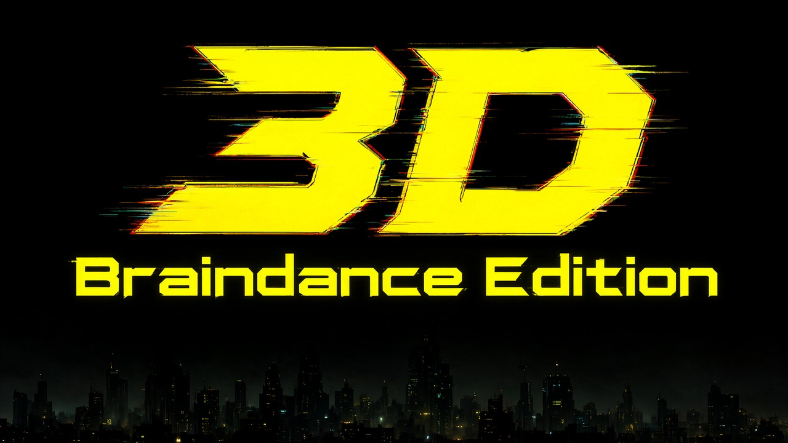

# 3D Braindance Edition Mod for Cyberpunk 2077

Play Cyberpunk 2077 in **real stereoscopic 3D** on any **3D display or VR headset with SBS support**: the game's
own stereo renderer on a big virtual screen, not a depth-map effect.

**Not VR: no head tracking, no motion controls!** You look at a 3D screen.

Download: [Nexus Mods](https://www.nexusmods.com/cyberpunk2077/mods/36323) or
[GitHub releases](https://github.com/vl3c/cyberpunk2077-3d-braindance-edition/releases).

## What it does

Patch 2.5's 3D Mode, built for a glasses-free 3D monitor, gives the world, HUD and weapon real depth, but needs
that monitor's software. This mod:

1. Provides a small stand-in for that software (its 3D SDK), unlocking **3D Mode** on a normal monitor.
2. Enables a hidden engine option (`SBSDebug`) to draw the eyes **side by side**, not interlaced for the
   monitor's lenticular panel.
3. Makes **menus readable**. The game draws menus, the map and loading screens as one flat picture split across
   the eyes; the mod squeezes it into each half.
4. Lets the game's own **DLSS Frame Generation** run in 3D Mode (the game turns it off there, because Samsung's
   monitor can't use it).

No game files are modified: the game loads the stand-in DLL through its own 3D support. The menu fix and frame
generation hook a few game functions through RED4ext.

## Requirements

- Cyberpunk 2077 **2.5** on Windows 10 or 11. Tested on Epic; Steam and GOG untested.
- [RED4ext](https://www.nexusmods.com/cyberpunk2077/mods/2380), or the setup script
  ([No RED4ext](#no-red4ext)), which leaves menus split and frame generation off in 3D.
- A headset with **half-SBS support**, or a 3D TV or monitor with an SBS mode. Tested: Quest 3 with Virtual
  Desktop.
- For frame generation: an RTX 40 (up to 2x) or RTX 50 (up to 6x). Tested on RTX 50; RTX 40 should work.
- **Own a glasses-free 3D monitor the game supports? Don't install this mod:** it switches the game to
  side-by-side output.

## Install

1. Install RED4ext, then this mod (Vortex, or extract into the game folder with `bin`, `engine` and `red4ext`).
2. Turn on **3D Mode** in the video settings. The screen shows two images side by side.
3. In your headset, view the PC screen as **half side-by-side** 3D (Virtual Desktop: the desktop screen's 3D
   mode, Half SBS). The game must run on the monitor the headset shows.

The mod sets itself up at every game start. For 2D, turn 3D Mode off in the game's video settings.

## Settings

- In game: **Depth** (0.5 to 1.0 suits a headset), **Weapon Depth**, **Motion Comfort** and **Preset**.
- **More 3D depth:** lower the game's **Field of View** (Gameplay settings), e.g. 90 to 80. The world looks
  life-sized, edges stretch less, and depth feels much stronger.
- `bin\x64\Braindance3D\Braindance3D-Settings.ini`: log level, 3D monitor (`Monitor = primary` on
  multi-monitor PCs) and menu fix (`[Menus] Squeeze = auto` or `off`).
- Each eye gets half the horizontal resolution, so **higher resolution looks sharper**. Rendering twice lowers
  the frame rate versus 2D.
- Stereo 3D can strain your eyes: take breaks or lower Depth.

## Recommended setup (Quest 3 + Virtual Desktop)

1. **4K screen.** Run the game borderless at 3840x2160 on a primary 3840x2160 virtual monitor (virtual display
   driver): 1920x2160 per eye. Virtual Desktop streams at most 3840x2160 per screen, so higher doesn't help. Or
   use NVIDIA DLDSR 2.25x on a 1440p monitor.
2. **Half SBS, matching refresh rates:** in Virtual Desktop, use Half SBS for the desktop screen and stream at
   the virtual monitor's rate (both 72 or both 90 Hz). Faster frames are dropped; a mismatch judders.
3. **Path tracing with DLSS Performance** (Balanced with headroom). DLSS renders the whole SBS frame at 1920x1080
   internally, so each eye starts from 960x1080.
4. **Frame generation:** pick **DLSS** Frame Generation in the game's graphics settings and restart the game (DLSS-G
   loads only at start). It stays on with 3D Mode (needs RED4ext and an RTX 40 or 50). The game's FSR and XeSS
   frame generation still turn off in 3D Mode.
   - On other GPUs, [OptiScaler](https://github.com/optiscaler/OptiScaler)'s FSR or XeSS frame generation may work
     on the side-by-side frame, but we haven't tested it (we tested OptiScaler's frame generation only with its
     DLSS-G output, on an RTX 50). Install it as `winhttp.dll`, not `winmm.dll` or `version.dll`, which RED4ext and
     Cyber Engine Tweaks use. Use one frame generation, not both: with OptiScaler's on, keep the game's off.
   - To use the game's DLSS frame generation with OptiScaler installed (for its upscaling), set `FGInput = nofg` and
     `FGOutput = nofg` in `OptiScaler.ini`. With `FGOutput = DLSSG`, OptiScaler holds DLSS-G even with
     `[FrameGen] Enabled = false`, so the game's Streamline skips it and the game drops DLSS from its Frame Generation
     list.
5. **Multiplier:** refresh rate / multiplier = the base frame rate needed; input lag follows it. We find 24+ playable
   for a screen you look at; many want 40+. RTX 40 stops at 2x; 3x+ needs RTX 50.
   - RTX 50: 72 Hz 3x needs 24; 90 Hz 3x needs 30; 120 Hz 4x needs 30.
   - RTX 40: 72 Hz 2x needs 36; 90 Hz 2x needs 45.
6. **Video memory:** 4K, path tracing and a high multiplier can fill even a 16 GB card. If the base rate collapses,
   lower texture quality or the multiplier. Photo mode (which turns frame generation off) can push it over and leave
   the frame rate low afterwards; restart the game if it doesn't recover.
7. **Field of View:** a flat image looks natural only when the game's FOV matches how much of your view the screen
   fills. Too wide, and everything looks small and far away and swells at the edges. With a large Virtual Desktop
   cinema screen, 80 looks much better than 90; go lower on a smaller or more distant screen.

## Troubleshooting

Logs: `braindance3d.log`, `Braindance3D-autosetup.log` and `Braindance3D-hooks.log` in `bin\x64\Braindance3D`
(`%LOCALAPPDATA%\Braindance3D` if the game folder is read-only).

- **Crash or no start after install or a game update:** disable the mod and report your game version.
- **3D Mode greyed out:** check RED4ext and the autosetup log. With several monitors, use `Monitor = primary` and
  the primary monitor.
- **Menus look wrong:** set `[Menus] Squeeze = off` and report with the hooks log.
- **Overlays look split in 3D:** the menu fix covers only overlays drawn before it, and only over menus, the map and
  loading screens. Cyber Engine Tweaks' overlay looks right over a game menu, so pause before opening it, but is split
  over 3D gameplay. OptiScaler's menu and FPS counter are always split in 3D. To use them, turn 3D Mode off in the
  game's settings; it switches live, with no restart. `FpsOverlayPos = 0` in `OptiScaler.ini` keeps the counter
  readable in the left eye.
- **No DLSS in the game's Frame Generation list with OptiScaler:** set `FGInput = nofg` and `FGOutput = nofg` in
  `OptiScaler.ini` (see the recommended setup).
- **Depth inside out:** use your viewer's swap-eyes option.

**Bugs:** report via [GitHub issues](https://github.com/vl3c/cyberpunk2077-3d-braindance-edition/issues) or the
Nexus Bugs tab with game version and store, GPU, how you view the 3D, and logs at `Level = 2` (settings ini).
Logs contain folder paths, which can include your Windows user name.

## No RED4ext, uninstall and other details

- **Registration:** the RED4ext plugin writes one per-user registry key, `HKCU\SOFTWARE\Samsung\Odyssey3DHub`,
  pointing the game at the SDK. Neither plugin nor script replaces the 3D monitor's
  own software.
- **No RED4ext:** from the full zip on
  [GitHub releases](https://github.com/vl3c/cyberpunk2077-3d-braindance-edition/releases) (Nexus omits the
  scripts), double-click `bin\x64\Braindance3D\Install-Braindance3D.bat` once, not as administrator. Rerun only if
  you move the game.
- **Uninstall:** remove the mod in Vortex, or delete its files including `red4ext\plugins\Braindance3D`. The
  leftover registry key points at a missing folder, so the stand-in is no longer found. To remove the key, run
  `Uninstall-Braindance3D.bat` (full zip) after removing the plugin.
- **Real 3D monitor owners:** the engine ini alone switches 3D Mode to side by side. After
  `Install-Braindance3D.bat -Force`, run the uninstaller before deleting the mod to restore the monitor
  software's setting.
- **Mod Organizer 2** isn't supported yet: the game needs the DLL in a real folder.
- **Other games:** the registry key isn't per game. The stand-in only works in `Cyberpunk2077.exe`; if another
  game for that 3D monitor misbehaves, uninstall before playing it.

## How it works and building

See [docs/TECHNICAL.md](https://github.com/vl3c/cyberpunk2077-3d-braindance-edition/blob/main/docs/TECHNICAL.md).
Build: `./build.sh` (MinGW-w64), or `./build.sh dist` for release zips. Tests: `tests/README.md`.

## Legal

This is an unofficial fan work and is not approved or endorsed by CD PROJEKT RED. It is not affiliated with,
endorsed by or supported by Samsung. Use it at your own risk: it changes how the game renders. The
`Odyssey3DSDK.dll` in this mod is not Samsung's SDK. It is an independent program written from scratch, and its
interface was worked out from how the game calls it, solely so that it can work with the game. It contains no
code, headers or binaries from CD PROJEKT RED or Samsung.

CD PROJEKT®, Cyberpunk® and Cyberpunk 2077® are registered trademarks of CD PROJEKT S.A. Samsung, Odyssey and
Odyssey 3D are trademarks of Samsung Electronics Co., Ltd. Meta Quest is a trademark of Meta Platforms, Inc.

Released under the [MIT License](LICENSE).
